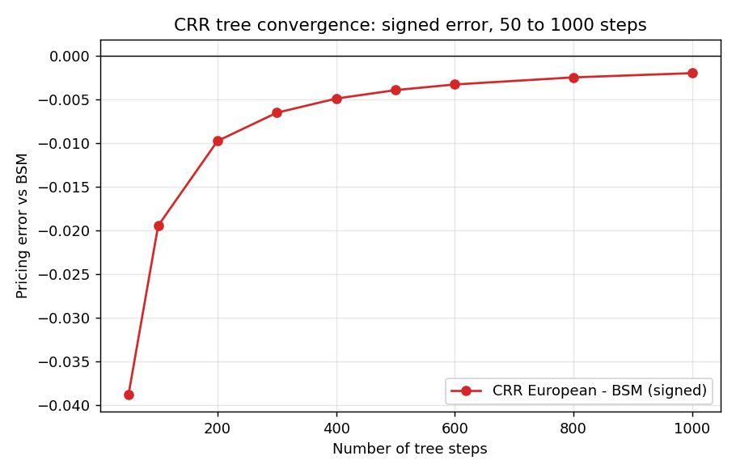
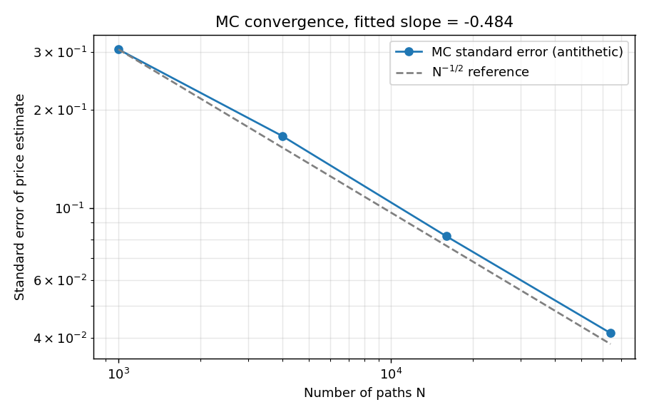
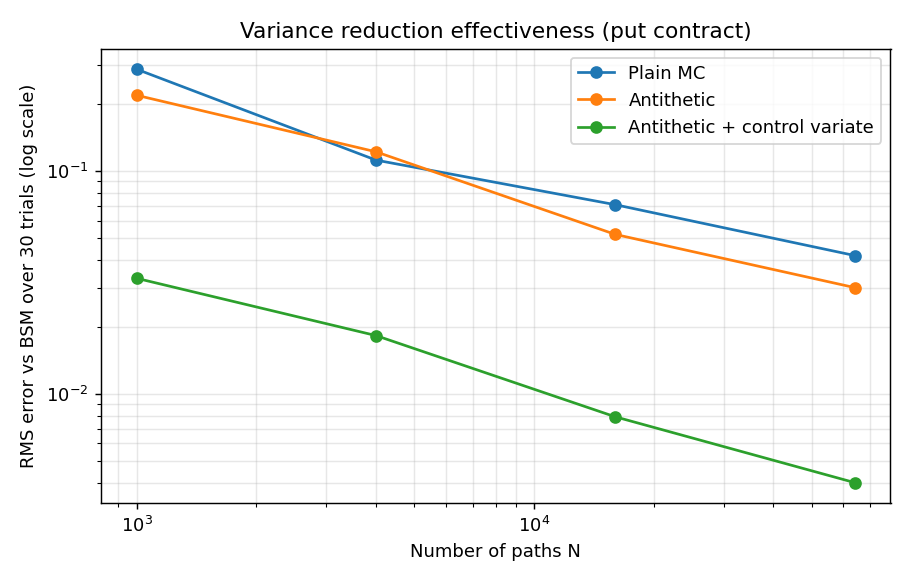
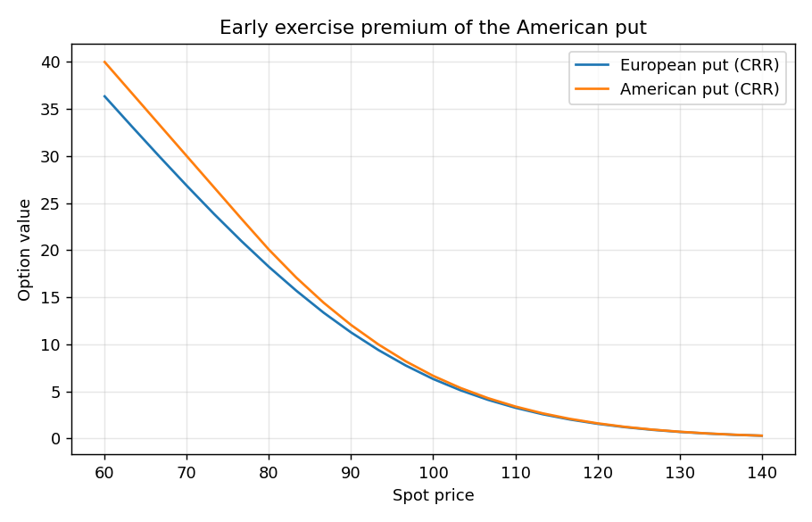
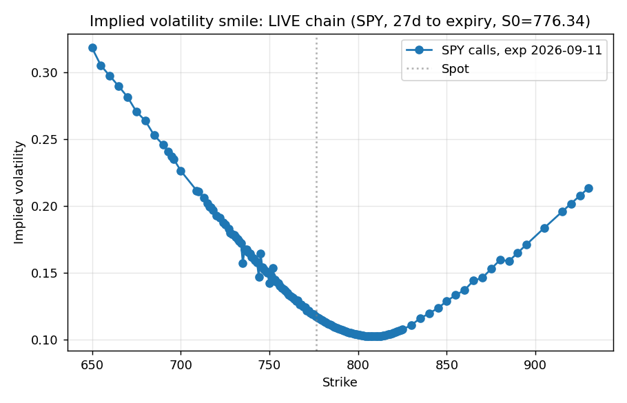

# Project I-2: Multi-Method Derivative Pricing and Greeks Engine

A single-file Python engine that prices European and American options with
Black-Scholes-Merton (with continuous dividend yield), Cox-Ross-Rubinstein
binomial trees, and variance-reduced Monte Carlo, plus analytic Greeks, a
hybrid implied volatility solver, a 75-cell triangulation harness, optional
QuantLib benchmarking, an implied volatility smile from a live option chain
(with a labeled synthetic fallback), and an eight-part correctness battery.

All pricing, Greeks, and correctness-check outputs use clearly labeled
synthetic parameters. No live market data is required for any of them. The
implied volatility smile is the one exception: it attempts a live option
chain over the network and falls back to an explicitly labeled synthetic
chain if no connection is available. No output here should be read as a
real-world trading signal.

## Quick start

```bash
pip install -r requirements.txt
python Multi_Method_Derivative_Pricing_Greeks_Engine.py
```

The script runs end to end in a few seconds: it prints BSM prices and Greeks,
European and American tree values, Monte Carlo estimates with confidence
bands, the eight validation checks, the full triangulation table, an optional
QuantLib comparison (skipped gracefully if QuantLib is not installed), an
implied volatility smile (live chain if reachable, synthetic otherwise), and
writes five PNG plots to the working directory.

Every part of the run is reproducible under a fixed seed except the implied
volatility smile, which intentionally reflects live market quotes when a
network connection is available and therefore differs run to run; this is
expected behavior for real-time data, not a reproducibility defect, and it
is the only source of run-to-run variation in the script's output.

Syntax check only:

```bash
python -m py_compile Multi_Method_Derivative_Pricing_Greeks_Engine.py
```

## File map

| File | Purpose |
|---|---|
| `Multi_Method_Derivative_Pricing_Greeks_Engine.py` | The complete engine, tests, triangulation harness, demo driver, and plots. |
| `Word_Document_Content.md` | Academic report content: abstract, methodology, application, validation, limitations, conclusion. |
| `LinkedIn_Project_Portfolio_Entry.md` | Portfolio entry: title, description, skills list, media recommendations. |
| `Plain_English_Project_Notes.md` | Non-technical explanation plus an interview-ready summary. |
| `README.md` | This file. |
| `requirements.txt` | Python dependencies. |
| `I2_mc_convergence.png` | Demo output: MC standard error versus path count with N^(-1/2) reference. |
| `I2_variance_reduction.png` | Demo output: plain MC vs antithetic vs antithetic plus control variate (put contract, RMSE over 30 trials per point). |
| `I2_american_vs_european.png` | Demo output: American put early-exercise premium across spot levels. |
| `I2_tree_convergence.png` | Demo output: CRR European tree signed error versus step count, 50 to 1000 steps. |
| `I2_iv_smile.png` | Demo output: implied volatility smile from a live SPY option chain, or a labeled synthetic chain if offline. |

## Convergence plots

The CRR European tree converges to the BSM price as the step count grows
from 50 to 1000; the error's envelope shrinks like 1/steps but is not
required to decrease monotonically at every step count, the well-known
"sawtooth" behavior of binomial trees (error 0.0388 at 50 steps down to
0.0019 at 1000 steps for the at-the-money contract shown):



Monte Carlo standard error decays at the theoretical N^(-1/2) rate (fitted
slope -0.484 from a log-log regression over 1,000 to 64,000 paths):



Layering antithetic variates and then a control variate on top of plain
Monte Carlo reduces the RMS error at fixed path count, measured honestly
over 30 independent trials per point rather than a single noisy draw (put
contract, the non-degenerate test of the control variate):



The American put's early-exercise premium is visibly positive across the
whole spot range, and the American curve never drops below the European one:



The implied volatility smile, produced by the same Brent-plus-Newton solver
used in the round-trip check, applied to a live SPY option chain:



## QuantLib benchmark

QuantLib was not installed in the environment this project was built and
validated in (`import QuantLib` raises `ModuleNotFoundError`), so the
QuantLib benchmark section is documented here as skipped rather than
silently omitted. `run_quantlib_comparison()` checks `HAS_QUANTLIB` and
prints an explicit "[QuantLib] Not installed" message when this happens; it
never claims a benchmark that did not run. In its absence, correctness is
still established by the triangulation harness (BSM vs. CRR tree vs. Monte
Carlo across the 75-cell grid above), which reconciles three independently
coded pricers rather than one, and by the eight-part validation battery
above. Anyone who installs `QuantLib-Python` and reruns
the script will get a per-cell QuantLib comparison table for free, since the
integration code is already written and only the import guard is gating it.

## Dependencies

- Python 3.10+
- numpy, scipy, matplotlib (required)
- yfinance (optional; only used to fetch a live option chain for the IV smile, falls back to a labeled synthetic chain if missing or offline)
- QuantLib (optional; only used for the benchmark section if installed)

## Using the engine in your own code

```python
from Multi_Method_Derivative_Pricing_Greeks_Engine import (
    OptionSpec, bs_price, bs_greeks, crr_price, mc_price, implied_volatility)

spec = OptionSpec(S0=100, K=105, T=0.5, r=0.04, sigma=0.25, q=0.01,
                  option_type="call")
print(bs_price(spec))                       # closed form
print(bs_greeks(spec)["delta"])             # analytic Greeks
print(crr_price(spec, steps=500, american=True))   # American tree
print(mc_price(spec, n_paths=100_000, seed=1))     # MC with CI
print(implied_volatility(5.20, spec))       # invert the model
```

OptionSpec validates T > 0 and sigma > 0 (and positive S0, K) at construction,
so invalid contracts fail fast instead of propagating silent nonsense.

## Validation summary (demo run)

| Check | Result |
|---|---|
| [1] Put-call parity residual | 0.0 (machine precision) |
| [2] American >= European | PASS (calls and puts) |
| [3] Analytic Greeks vs finite differences | rel. errors 4e-11 to 1.3e-8 |
| [4] Delta parity delta(call) - delta(put) - e^-qT | 0.0 (machine precision) |
| [5] MC convergence log-log slope | -0.484 (theory -0.500) |
| [6] IV round-trip | 0.27 recovered as 0.2700000000 |
| [7] MC 95% band coverage (200 trials) | 95.0% |
| [8] Variance reduction, call target, N=64,000 | antithetic 1.27x; control variate collapses to floating-point noise (target = control) |
| [8] Variance reduction, put target (genuine test), N=64,000 | antithetic 1.39x; antithetic + control variate 10.45x vs plain MC |
| Max \|CRR - BS\| over 75-cell grid | 0.0174 (O(1/steps) tree error) |
| Max \|MC - BS\| over grid | 9e-6 (control variate active, call target) |
| Grid-level MC 2-stderr coverage (75 cells, control variate off) | 90.7% (68/75 cells) |
| IV smile round-trip solver | same solver used for live/synthetic chain as for the round-trip check |

## Notes and limitations

- The control variate is the European call payoff at the same strike; for
  call targets it is perfectly correlated with the target and the MC variance
  collapses to numerical zero by construction, which is why the call row
  above reports floating-point noise rather than a numeric ratio. Put targets
  get a genuine variance reduction through parity-driven correlation, and it
  is a real order-of-magnitude effect (10.45x RMSE reduction at 64,000 paths),
  consistent with the rule of thumb that a good control variate should cut
  error by roughly an order of magnitude.
- When antithetic variates and the control variate are combined, the control
  coefficient must be estimated on the antithetic PAIR averages, not on the
  raw pooled sample of individual paths. Estimating it on the pooled sample
  (an earlier version of this script did this) ignores the negative
  correlation induced by antithetic pairing and actually inflates variance
  instead of reducing it; this was caught by comparing the measured RMSE
  against the closed-form expectation and has been fixed in `mc_price`.
- MC standard errors and confidence bands are likewise computed on the
  antithetic pair averages, so the reported 95.0% coverage over 200 trials is
  a genuine, non-conservative measurement rather than an approximation. This
  is a repeated-trial coverage measurement on one contract; a second,
  independent coverage number, computed once across all 75 triangulation
  cells rather than across repeated trials of one cell, comes out at 90.7%
  (68/75), consistent with a true rate near 95% given the sampling noise of
  only 75 Bernoulli trials.
- The CRR tree converges with the classic oscillation at O(1/steps); the
  largest tree errors sit in the long-maturity, high-volatility corner of the
  grid, as theory predicts.
- The model assumes constant volatility and rates; smile-consistent pricing
  for exotic payoffs would require local or stochastic volatility extensions.
  The IV smile output here is the market-implied smile recovered by the
  solver, not a parametric smile model.
- Monte Carlo here is European-only; American Monte Carlo would need a
  Longstaff-Schwartz style regression layer.
- QuantLib is a soft dependency by design: everything works without it. It
  was not installed in the environment this README was generated in, so the
  QuantLib benchmark section is documented as skipped rather than run; the
  triangulation harness (BSM vs CRR vs MC) is the validation path that still
  runs and is reported above.
- yfinance is a soft dependency for the IV smile only; when it or network
  access is unavailable, the script falls back to an explicitly labeled
  synthetic option chain built from a known volatility skew.
