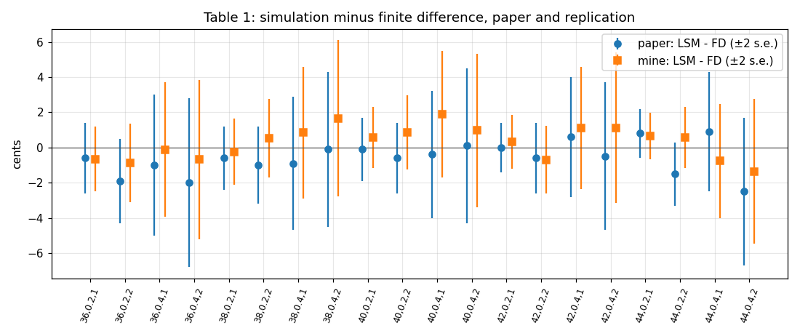
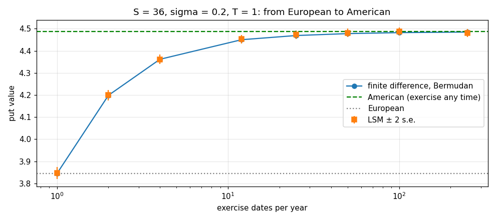

# American options by simulation: replicating Longstaff & Schwartz (2001)

A replication of Francis Longstaff and Eduardo Schwartz, *Valuing American Options by Simulation: A Simple Least-Squares Approach* (Review of Financial Studies, 2001). The method prices options with early exercise by Monte Carlo: at each exercise date, a least-squares regression across the simulated paths estimates the value of waiting.

Everything is in one notebook: [`Longstaff_Schwartz_2001_Replication.ipynb`](Longstaff_Schwartz_2001_Replication.ipynb).

## What was replicated

| Paper | Result here |
|---|---|
| Section 1, eight-path worked example | both regressions, every exercise decision, American 0.1144 and European 0.0564, exactly |
| Table 1, Black-Scholes European values (20) | all 20 equal to three decimals |
| Table 1, finite-difference American values (20) | the benchmark turns out to be Bermudan (50 dates/yr); mean gap 0.09 cents, max 0.6 cents |
| Table 1, simulated (LSM) values (20) | every row within 2 standard errors of the paper (largest \|z\| = 1.63); 15/20 within a cent of the finite-difference value (paper: 16/20) |
| Table 2, in-sample vs out-of-sample (40 runs) | mean differences −0.11 and +0.05 cents (paper −0.2 and +0.1); no sign of overfitting |
| Section 8.3, rescaling and basis choice | the Laguerre basis on raw prices is 6 cents off; dividing by the strike fixes it. Polynomial and Hermite bases agree within 0.2 cents; a trig basis is weaker |

One difference is reported rather than tuned away. Across Table 2, the paper's simulated prices sit about 0.84 cents below the finite-difference value, while this implementation sits 0.03–0.16 cents below. Four alternative implementations were tested (regressing on all paths, a smaller basis, Euler paths, single precision) and none reproduces the paper's level on its own.



## Beyond the paper

The value of the put as exercise dates are added, from one a year (European) to 250 a year, against the continuous-exercise American value from finite differences:



## Data

None. Stock paths are simulated from geometric Brownian motion under the risk-neutral measure with the paper's parameters (K = 40, r = 6%, S = 36–44, σ = 20%/40%, T = 1/2 years). There's no historical data and no backtest.

## Running it

```bash
pip install -r requirements.txt
jupyter notebook Longstaff_Schwartz_2001_Replication.ipynb
```

The full run takes about ten minutes on a laptop, mostly the 300 or so Monte Carlo valuations and the finite-difference grids. Each valuation uses 100,000 paths, so allow about 200 MB of free memory.

## References

- Longstaff, F. and Schwartz, E. (2001). Valuing American Options by Simulation: A Simple Least-Squares Approach. *Review of Financial Studies*, 14(1), 113–147.
- Andersen, L. and Broadie, M. (2004). Primal-Dual Simulation Algorithm for Pricing Multidimensional American Options. *Management Science*, 50(9), 1222–1234.
